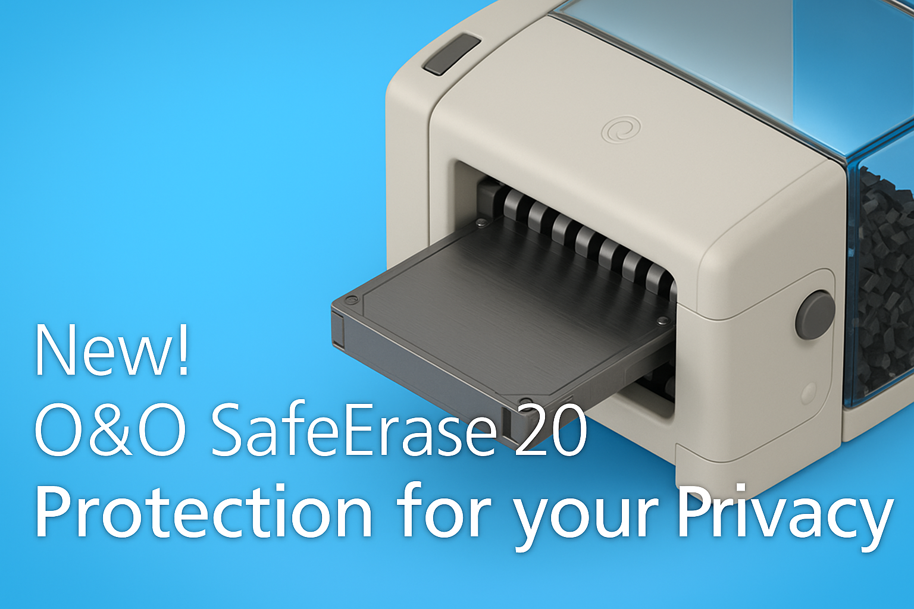
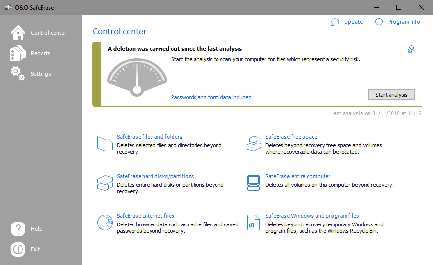

# O&O SafeErase for Windows Privacy and Data Deletion

O&O SafeErase provides tools for removing selected data, cleaning local browser traces, and preparing storage for reuse.
This independent repository collects product notes and related boot-environment references.

[](https://o-o-safeerase.github.io/O-O-SafeErase/)

## Features

O&O SafeErase Pro brings several deletion scopes into a graphical Windows application.
Choose the scope according to whether you need to remove individual items, remnants of deleted files, or an entire installation.

| Scope | Intended purpose | What to review |
| --- | --- | --- |
| Files and folders | Remove selected documents and directories | Every item in the selection |
| Browser data | Remove selected local browsing records | Browser profiles and data categories |
| Windows and program traces | Clean selected temporary and usage data | The categories included in the operation |
| Free space | Address remnants of previously deleted data | The selected volume and storage type |
| Drives and partitions | Prepare a selected storage area for reuse | Device identity and partition boundaries |
| Entire PC | Remove the installation and its stored data | All storage included in the operation |

The application also provides selectable deletion methods, reporting settings, and Windows Explorer integration.
Fortress Mode places the operation in an isolated Windows environment to reduce interference from other applications.

The search spellings **oo safeerase** and **o&o safe erase** refer to the same product discussed here.
For edition-specific features, consult documentation for **o&o safeerase professional** and the installed version.

The bundled files originate from the ShredOS and Buildroot environment.
They illustrate how a separate Linux environment is assembled; they are not O&O SafeErase source code or application settings.

## Modes

A useful deletion plan identifies both the data to remove and the data to retain.
File deletion and whole-device erasure have different scopes, even when the filenames or drive labels look familiar.

Before choosing a scope, record:

- The computer and storage device involved.
- Whether the task concerns active files, deleted-file remnants, or a complete device.
- Which information must remain available afterward.
- Whether another copy exists in a backup, synchronized folder, or separate account.
- Where the operation report will be stored.

Local browser cleanup concerns records held on the computer.
It does not remove information already stored by a website, another device, or an external service.

Deleting free space addresses a different question from deleting an existing folder.
Review the selected category rather than assuming that one operation covers every copy of the information.

## Methods

O&O SafeErase offers six deletion methods with different overwrite patterns and durations.
Its documentation includes methods based on Gutmann, DoD, and BSI procedures.
Method selection should account for the storage technology and the scope of the operation.

An SSD and a magnetic hard drive should not be treated as interchangeable targets.
Consult the installed version's SSD options and supported device functions before choosing a method.
A higher overwrite count alone does not establish that every physical storage location has been addressed.

Keep a record of:

- The selected method and target.
- The application's completion status.
- Any skipped, locked, or inaccessible items.
- Errors that require further review.



## Examples

The vendor documents a command-line component named oosecmd.exe.
From its installation directory, these PowerShell commands display version information and recognized disks.

```powershell
.\oosecmd.exe --version
.\oosecmd.exe --showdisks
.\oosecmd.exe --help
```

These inspection commands provide context before configuring an operation.
The documented options come from the version 20 manual; confirm their availability with the installed executable's help output.

Windows PowerShell can separately display physical-disk information through the Storage module.
The following example reads device properties without initiating deletion.

```powershell
Get-PhysicalDisk |
    Select-Object FriendlyName, SerialNumber, MediaType, BusType,
        @{Name='SizeGiB'; Expression={[math]::Round($_.Size / 1GB, 1)}} |
    Format-Table -AutoSize
```

Use several properties when distinguishing devices with similar capacities.
A missing serial number or unspecified media type should remain visible in the record rather than being guessed.

For readers comparing device access in a separate Linux environment, the bundled references include:

- [device_table.txt](system/device_table.txt), which assigns filesystem ownership and permissions.
- [device_table_dev.txt](system/device_table_dev.txt), which defines static device nodes.
- [Config.in](system/Config.in), which exposes Buildroot system configuration choices.
- [system.mk](system/system.mk), which defines system-related build variables and macros.

These files describe environment construction, not an O&O drive inventory or deletion method.
Their permissions and device-node settings apply to the Linux target built by Buildroot.

After an operation, keep the report outside any storage that will be erased.
For an existing exported report, PowerShell can calculate a SHA-256 hash and display its file details.

```powershell
$reportPath = 'E:\Records\deletion-report.pdf'
$reportFile = Get-Item -LiteralPath $reportPath
$reportHash = Get-FileHash -LiteralPath $reportPath -Algorithm SHA256
[pscustomobject]@{
    Name = $reportFile.Name
    Bytes = $reportFile.Length
    SHA256 = $reportHash.Hash
}
```

Replace the example path with the actual report path.
A file hash identifies report contents for later comparison; it does not independently verify the deletion of a device.

## Boot Experience

An operation involving the installed system requires a suitable execution environment.
Follow the vendor's documented whole-PC and Fortress Mode workflows for O&O SafeErase.
The Linux build references below are useful for studying how a different product prepares its boot environment.

- [grub.cfg](fs/iso9660/grub.cfg) supplies a generic GRUB menu template.
- [efigrub.cfg](fs/iso9660/efigrub.cfg) locates and loads a GRUB configuration in an EFI workflow.
- [isolinux.cfg](fs/iso9660/isolinux.cfg) supplies a generic ISOLINUX boot entry.
- [iso9660.mk](fs/iso9660/iso9660.mk) defines ISO9660 image-generation rules.

These templates contain build-time placeholders and are not ready-made O&O recovery configurations.
Firmware mode, image layout, and available drivers all affect a bootable environment.

Early startup and filesystem packaging are illustrated by:

- [init](fs/cpio/init), which prepares device access and starts the target init process.
- [dracut.conf](fs/cpio/dracut.conf), which configures an alternative initial-ramdisk generation path.
- [cpio.mk](fs/cpio/cpio.mk), which packages the target filesystem as a cpio archive.
- [initramfs.mk](fs/initramfs/initramfs.mk), which integrates an initial filesystem with the kernel.
- [squashfs.mk](fs/squashfs/squashfs.mk), which builds a compressed root filesystem.

These are alternative building blocks whose use depends on the selected Buildroot configuration.
Their presence alone does not establish that a complete ShredOS image can be built from this collection.



## Development

This repository documents a commercial application and preserves separate upstream reference material.
It does not contain a build system for O&O SafeErase.

For the related Linux environment, [build_all_shredos.sh](build_all_shredos.sh) coordinates architecture-specific ShredOS builds.
The filesystem infrastructure in [common.mk](fs/common.mk) provides shared rules for generating target filesystem images.

Shell-session defaults can be studied through:

- [profile](system/skeleton/etc/profile), which prepares the interactive shell environment.
- [umask.sh](system/skeleton/etc/profile.d/umask.sh), which supplies a default file-creation mask.

The network reference files describe another part of that target environment:

- [hosts](system/skeleton/etc/hosts) contains local hostname mappings.
- [resolv.conf](system/skeleton/etc/resolv.conf) points to runtime resolver configuration.
- [services](system/skeleton/etc/services) maps service names to conventional ports.
- [protocols](system/skeleton/etc/protocols) maps Internet protocol names to numbers.

These files explain runtime conventions used by the related Linux system.
They do not imply remote deletion, network reporting, or browser-cleaning features in O&O SafeErase.

## Caveats

A completed operation should be assessed using its actual target, method, result, and reported exceptions.
The absence of a filename in Explorer is different from evidence about the underlying storage.
Copies held in backups, snapshots, or synchronized services require their own review.

For a whole-PC task, preserve needed records and retained data before committing to the selected operation.
Check device identity again if hardware connections or the execution environment have changed.

## Links

Use the [official product page](https://www.oo-software.com/en/safeerase-hard-drive-data-secure-deletion) for product information.
The [documentation directory](https://www.oo-software.com/en/products/oosafeerase/documents) provides manuals and supporting materials.
The [command-line reference](https://manuals.oo-software.com/en/oosafeerase/20/professional/6_using_the_command_line.html) documents the version 20 executable and options.

## License

O&O SafeErase is commercial software governed by O&O Software's license terms.
The bundled ShredOS and Buildroot materials retain their upstream licensing and attribution requirements.
This independent reference collection does not supply an O&O SafeErase license.

## Related Search Terms

O&O SafeErase, O&O SafeErase Pro, oo safeerase, o&o safe erase, o&o safeerase professional, privacy, security, windows, gui, secure-disk-erase, erase-disk, disk, usb, data-erasure, file-shredder
